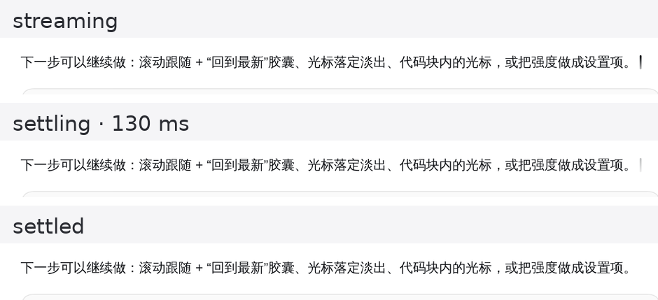
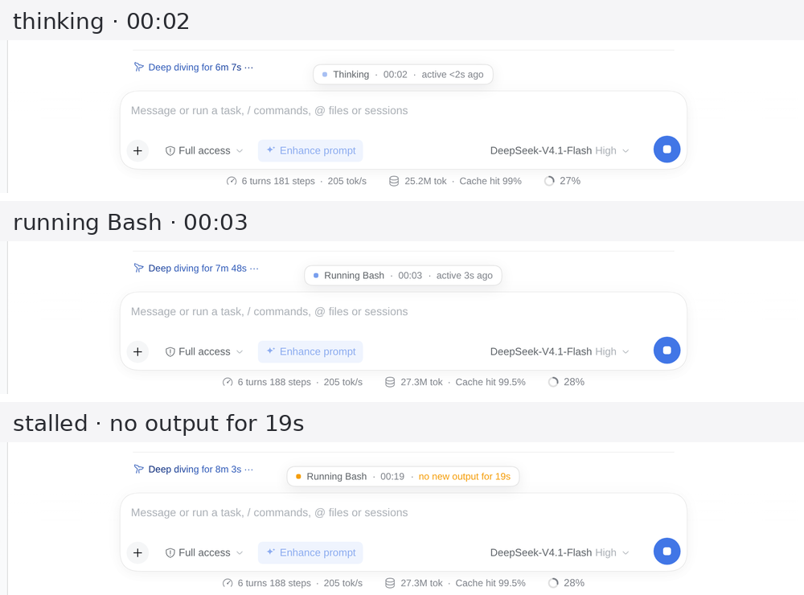

# 流式输出美化（Stream polish）

给 Agent 输出的两个阶段各加一层克制的观感：

- **流式时**：新段落柔和淡入，正在写的段落末尾有一枚呼吸光标，回复落定时光标淡出。
- **等待时**：输入框上方浮出一枚运行胶囊，显示当前阶段、已用时长和最近活动；超过 15 秒没有新输出时变成琥珀色的「无新输出」。

样式和观察器都在 Client 半，不改渲染逻辑、不改会话数据、不读模型输出。滚动跟随和「回到最新」仍由 Chat 自己负责，这个插件没有重复实现。

## 流式时




- **块级淡入**：流式过程中新挂载的段落、标题、列表项、代码块、引用和表格，做 160ms 的 `opacity 0→1` + `translateY(4px)→0`。已经在屏幕上的块不会因为后续 token 重播动画。
- **呼吸光标**：最后一层文本块末尾显示 2px 圆角竖线，1.2s 呼吸一次，底部渐隐。
- **落定淡出**：`data-streaming` 被移除时，给根节点加 340ms 的 `data-dsh-sp-settling`，光标在 260ms 内淡到 0，而不是一帧消失。
- **不重排**：光标用负右边距抵消自身宽度；实测落定前后最后一个字符的 `x/y/width`、段落高度和宽度全部为 0 位移。
- **降级**：`prefers-reduced-motion: reduce` 下关闭淡入、呼吸和落定淡出；`forced-colors: active` 下用 `CanvasText` 绘制。

## 等待时



运行胶囊挂在 `conversation.input.dock`，绝对定位在 composer 上方，因此出现和消失都不会改变输入框高度或推动正文。它显示：

- **阶段**：`Thinking`（没有工具、没有正文流）、`Running Bash` / `Running Read`（当前运行的命令或工具）、`Writing reply`（正文在流）。
- **已用时长**：当前阶段从开始到现在的 mm:ss。
- **最近活动**：最后一次正文 token、工具输出或状态变化距今多久。
- **停滞提示**：15 秒没有新输出后，圆点和活动文案变成琥珀色，显示 `no new output for 19s`；不会直接判死，也不会伪造百分比进度。

阶段判定方式：

- `[data-chat-flow]` 里出现带 `data-shimmer` 的运行行时，取最后一个可见运行行的首行作为工具名（`Bash`、`Read`、`Write`…）；`Running commands` 统一显示为 `Running commands`。
- 没有运行行时，`[data-streaming]` 存在即为 `Writing reply`，否则为 `Thinking`。
- `[data-chat-running]` 里的总时长文字、`[data-shimmer]` 里的计时、纯 `12s` / `1m 5s` 文本都不算“新输出”，否则停滞检测永远不会触发。

## 本轮步骤面板

同一处 `conversation.input.dock` 上还有 `id: step-panel` 的列表项，逐条列出**最新一轮**的思考、回复和工具调用。它按 composer stack 的正常文档流排在输入框上方，会占据真实高度并把正文推上去，**不覆盖**最后一张工具卡；列表自己滚动，不接管正文滚动。

每条占一行，四个字段固定：

| 字段 | 来源 | 示例 |
| --- | --- | --- |
| 动作 | 工具名（`Bash`/`Read`/`Write`…，未知工具保留原名）或阶段（思考 / 回复） | 运行命令 |
| 对象 | 工具参数里最具体的一个：`command`、`file_path`、`pattern`、`query`、`url`、`description`；思考/回复取首个非空行 | `npm test` |
| 状态 | `running` / `pending` / `done` / `error`，来自 Tool 生命周期或 Assistant 的 interrupted 标记 | 进行中 |
| 用时 | Tool 结果用 `time - callTime`，运行中的调用按秒累加；Assistant 用 `completedTime - stepStartTime` | 0.5s |

> 本档案同时启用了 `stream-aura`，它也会在同一个位置渲染“当前轮过程”步骤清单（`steps: rail`）。两个列表同时开启会上下堆叠；要么把 `stream-aura` 切成单行模式（`steps: line`），要么在设置页关掉其中一个。

数据来自 Chat 的公开快照，不读 DOM：

- `useChat`（`session` 作用域的框架标准 prop）取 `ChatSnapshot`；
- `timeline.turnOrder` 决定“本轮”，`timeline.turns` 提供 step 起点；
- `legacy.nodes` 里的 Assistant 节点给出思考/回复块和 `timing`，Tool-result 节点给出 `callTime → time`；
- `legacy.runningCalls` 给进行中的工具，`legacy.partial` 给正在流式的思考/回复前缀；
- 只有 `stepPanelRows` 条可见，更早的折成一行“更早 N 条”。
- 运行期间显示；本轮结束后保留 8 秒再收起，与运行胶囊的静默退出节奏一致。
- 运行胶囊开启时，阶段/已用时长/最近活动移入面板标题栏，独立的浮动胶囊在面板可见期间隐藏，避免压在标题上。
- `replaceToolRows: true` 时，面板可见期间原生工具行（`[data-chat-flow] [data-tool]`）隐藏，面板消失后恢复；这会把 diff、命令输出和工具结果暂时从正文里拿掉。

增量更新：行按 `seq`（已落定节点）与开始时间（运行中调用）排序；运行中的用时每秒 tick 一次，其他时刻不重建列表。新增/删除行只影响列表本身，不会重挂载回答正文，也不会改变展开状态。`stepPanelMotion` 关闭时没有入场动画；系统 `prefers-reduced-motion: reduce` 下同样自动关闭。

## 思考翻译

展开一条“思考”后，正文上方出现与现有界面一致的入口：**查看原文** ↔ **查看译文**。两个视图复用 Chat 自己的 `conversation.chat.reasoning.content` Factory，只替换传入的文本，因此 Markdown 排版、代码块和流式光标都不变；切换只改本地视图状态，不折叠、不重挂载，也不打断正在流式到达的正文。

翻译由可选的 Host 服务 `translator` 完成（`@deepseek-ai/dsh-experimental-translator`，通常随 `cot-translation` 组合包挂载）：

- **目标语言由用户配置**：`translationTargetLanguage`，默认 `zh-CN`；`auto` 跟随界面语言。优先级与其它配置相同（内置默认 < 档案 `cordis.patch.yml` < 本浏览器保存值）。
- **只发稳定前缀**：完整段落优先；没有空行时取已完成行；单段过长时按请求上限切块。未完成的末尾片段始终保留原文，所以流式输出从不等翻译。
- **增量追加**：已译片段按游标累积，新段落到达后只翻译新增部分，不重发整段。
- **请求边界**：浏览器 `POST ./api/stream-polish/translate`；Host 校验长度（`translator.maxTextChars`）、语言标签、provider 与 Session 标识，再调用 `translator.resolve()` / `translate()`。`translationTimeoutMs` 同时约束浏览器与 Host 的等待。
- **降级**：服务未挂载、超时、限流、HTTP 失败或无效响应时保留原文，工具栏显示“翻译暂不可用，已显示原文”+ **重试**；不会自动重试，也不会把原文转投给另一个 provider。展开区卸载、切换 provider/语言、关闭插件都会 abort 未完成请求，迟到的结果被忽略。
- **隐私**：`translation` 默认 **false**。开启后展开的思考内容会发送给所选匿名端点（Bing/Google），可能包含私有代码或对话细节；原文始终保留。

与官方 `cot-translation` 组合包的关系：两者使用同一个 `translator` 服务。本插件只在 `translation: true` 且 Host 发布 `capabilities.translation.available` 时，以 `priority: -1` 遮蔽 `conversation.chat.reasoning.body` 这个 single slot；关闭开关会撤回注册，内建 body 原样回来。若档案同时启用官方组合包，请二选一，避免同一位置出现两套翻译工具栏。

## 配置

行为全部由一个配置对象决定：1.2.0 的流式装饰默认值保持不变，步骤面板默认开启，思考翻译默认关闭（发送外部请求，必须显式开启）。改配置不需要改源码，刷新页面即生效。

加载优先级（低 → 高）：

| 优先级 | 来源 | 位置 |
| --- | --- | --- |
| 1 | 内置默认值 | `config.js` 的 `SPEC`，与 1.0.0 完全一致 |
| 2 | 包自带 patch | 本包 `cordis.patch.yml` 中 `stream-polish` 行的 `config` |
| 3 | 档案 patch 覆盖 | `$DSH_PROFILE_DIR/cordis.patch.yml` 中同 id 的 `config` 段 |
| 4 | 浏览器本地覆盖 | `localStorage` 键 `dsh.stream-polish.settings`（调参、临时调试） |
| 5 | 测试钩子 | `window.__DSH_SP_STALL_MS__`，仅覆盖 `stallMs` |

Host 半在行激活时用 `config.js` 校验一次：合法值随 `webserver/index-inject` 下发给 Client 半，非法值在 Host 控制台报一条消息并回落到默认值，不会抛错、不会让页面变白。Client 半再叠加第 4、5 层，并用同一张表校验浏览器本地覆盖。

配置项（全部可选，未设置即取默认值）：

| 配置项 | 类型 | 默认值 | 取值范围 | 作用 | 必填 |
| --- | --- | --- | --- | --- | --- |
| `enabled` | boolean | true | true / false | 总开关；false 时不挂样式、观察器和运行胶囊 | 否 |
| `blockFade` | boolean | true | true / false | 流式期间新挂载的 Markdown 块是否做淡入 | 否 |
| `blockFadeMs` | number（整数） | 160 | 80–600 | 块淡入时长，毫秒 | 否 |
| `caret` | boolean | true | true / false | 正在书写的末尾是否显示呼吸光标 | 否 |
| `caretPeriodMs` | number（整数） | 1200 | 400–4000 | 光标一次呼吸的周期，毫秒 | 否 |
| `settleFade` | boolean | true | true / false | 落定时光标是否淡出；false 则直接消失 | 否 |
| `settleMs` | number（整数） | 260 | 100–1000 | 落定淡出时长，毫秒；清理定时器取该值加 80ms | 否 |
| `stallMs` | number（整数） | 15000 | 500–600000 | 多久没有新输出就显示「无新输出」，毫秒 | 否 |
| `runStrip` | boolean | true | true / false | 输入框上方是否显示运行胶囊 | 否 |
| `showElapsed` | boolean | true | true / false | 胶囊是否显示当前阶段已用时长 | 否 |
| `showActivity` | boolean | true | true / false | 胶囊是否显示最近活动 / 停滞文案 | 否 |
| `stepPanel` | boolean | true | true / false | 输入框上方是否显示本轮步骤面板 | 否 |
| `stepPanelRows` | number（整数） | 5 | 1–20 | 步骤面板最多同时显示几条，更早的折叠成一行计数 | 否 |
| `stepPanelAccent` | string（文本） | #4f8cff | 六位十六进制 `#RRGGBB` | 步骤面板强调色（运行中工具、进行中状态） | 否 |
| `stepPanelMotion` | boolean | true | true / false | 步骤增删时播放 160ms 淡入/位移动效；减少动态效果时自动关闭 | 否 |
| `stepPanelPhaseColors` | boolean | true | true / false | 按阶段着色：思考中性、工具强调、失败红、完成绿 | 否 |
| `replaceToolRows` | boolean | false（本档案 patch 置 true） | true / false | 面板可见时隐藏正文里的原生工具行，关闭即恢复；工具结果/diff/命令输出不再显示在原位 | 否 |
| `toolCardPolish` | boolean | true | true / false | 原生工具行圆角、内描边、悬停与运行/失败状态色；只改绘制，不改宽高与点击区 | 否 |
| `translation` | boolean | false | true / false | 是否把展开的思考内容发送给翻译服务（默认关闭） | 否 |
| `translationProvider` | enum | bing | bing, google | 翻译服务；两者都是匿名端点 | 否 |
| `translationTargetLanguage` | string（文本） | zh-CN | `auto` 或语言标签，如 zh-CN、en、ja | 翻译目标语言；auto 跟随界面语言 | 否 |
| `translationTimeoutMs` | number（整数） | 8000 | 1000–30000 | 单次翻译请求超时，毫秒 | 否 |
| `logLevel` | enum | warn | silent, error, warn, info, debug | 本插件日志级别 | 否 |

`logLevel` 只影响本插件自己的输出：`silent` 全静音；`error` 只报错误；`warn`（默认）在配置有误时告警，合法配置下完全静默；`info` 额外报告一次「configuration accepted」；`debug` 再打印解析后的完整配置对象。

示例——包自带 patch 或档案 patch 里都可以这样写：

```yaml
- id: stream-polish
  config:
    stallMs: 8000        # 8 秒没有新输出就提示
    caretPeriodMs: 1600  # 光标呼吸慢一点
    showActivity: false  # 胶囊只留阶段和时长
```

临时调参（只影响当前浏览器，不改任何文件）：

```js
localStorage.setItem('dsh.stream-polish.settings', JSON.stringify({ caret: false }))
location.reload()
```

写错时的报错（配置项名 + 期望值 + 实际收到的值 + 回落到什么）：

```text
[@local/stream-polish] config.stallMs must be an integer between 500 and 600000; got 'fast'; using 15000.
[@local/stream-polish] config.logLevel must be one of "silent" | "error" | "warn" | "info" | "debug"; got 'verbose'; using 'warn'.
[@local/stream-polish] config.typoKey is not a recognized option (ignored).
```

配置项少于要求的粒度也没关系：`enabled: false` 只是不挂载任何界面，行仍留在 Loader 里，改回 `true` 刷新即可恢复。

## 设置页

插件挂载后，配置就在它自己的**详情页**里：**设置 › 插件 › 已安装插件 › 流式输出美化 ›（点开）**，在包名与版本下面、行列表上面。这走的是 `plugins.bundle.config` 插槽（按包名 keyed），所以是原生详情页的一部分，不是另开的标签页。

排版是「主开关 + 分组卡片网格」，不是一长串行：

- **预览**：最上面是迷你对话片段，用当前配置实时重放——新段落按你填的毫秒数淡入、末尾光标按你设的周期呼吸、胶囊按开关显示阶段/时长/活动；改任意一项立刻看到差别，点「重播」再放一次。
- **显示**：总开关单独一行（横跨整宽，它管着全部），下面六个开关按卡片三列排布，窄屏自动降成一列。
- **时长**：四个数字字段各一张卡片，卡片里是输入框 + `ms` + 取值范围；越界只标红并退回上一个合法值，不会写进配置。
- **诊断**：日志级别单独一行 `silent` / `error` / `warn` / `info` / `debug`。
- **依赖置灰**：光标关掉时「落定淡出」及其时长自动置灰，运行胶囊关掉时「已用时长 / 最近活动」置灰，块淡入关掉时它的时长置灰——不用猜哪一项还有效。
- **恢复默认**：清掉本浏览器的覆盖值，回到档案里配置的默认值。

改动**立即生效**，不需要刷新：样式表按新配置重建，观察器按开关增删，胶囊的段落跟着 `showElapsed` / `showActivity` 变化。标题右侧出现「本浏览器已改动」的标记，表示当前值和档案默认值不同。

保存位置是 `localStorage` 的 `dsh.stream-polish.settings`，**只属于当前浏览器**；要改所有浏览器的默认值，仍然改档案里的 `cordis.patch.yml`（见上一节的优先级表）。

> 本档案里的 `cordis.patch.yml` 把 `runStrip` 关掉了：`stream-aura` 已经在同一个位置渲染运行卡片，两个胶囊会叠在一起。想要小胶囊时在设置页打开「运行胶囊」即可。

## 在线升级

设置页顶部是「在线升级」卡片：显示当前版本与提交、远端版本与提交，两个按钮——**检查更新**、**一键升级**。

升级走的就是这个仓库自己的 git 工作区（`link:` 安装，所以不需要包管理器）：

1. `git fetch --prune origin`，比较 `HEAD` 与上游分支，算出落后/领先多少提交；
2. 只做 `git merge --ff-only`，也就是**只快进，绝不改写历史**；
3. 升级后重新读 `package.json`，包名或 version 不对就 `git reset --hard` 回滚；
4. 成功时 Host 半调用 Loader 的 `hmr.reconcileProfile()`，把改动过的模块重新导入，所以新的 `index.js` 不用重启进程也生效；浏览器那半刷新页面即可。

安全边界：

| 情况 | 行为 |
| --- | --- |
| 工作区有未提交改动 | 拒绝，提示先提交或 stash，工作区不动 |
| 本地领先上游（有未推送提交） | 拒绝快进，提示先处理这些提交 |
| 上游包名变了 | 拒绝，避免装成另一个包 |
| 拉取或校验失败 | 自动 `reset --hard` 回到升级前的提交 |
| 不在 git 工作区 / 没有远端 / detached HEAD | 明确报错，不尝试任何写入 |
| 网络抖动、连接超时 | 自动重试一次；仍失败则归类为「超时 / 连不上 / 需要凭据」，而不是把 `Command failed: git …` 原样丢给用户 |
| Host 进程没有 HMR | 升级仍然完成，但会提示需要重启 `dsh` |

「检查更新」碰到网络问题不会像以前那样只显示一行 `Command failed: git -C …`：`lib/update.js` 会把失败归类成 `fetch-timeout` / `fetch-offline` / `fetch-auth` / `git-missing` / `status-failed`，给一句能行动的中文说明，原始 stderr 留在 `detail` 里便于排查。git 调用带 `GIT_TERMINAL_PROMPT=0`，需要凭据的仓库会立刻失败而不是挂住等输入。

接口都在 `/api/stream-polish` 下，走 Connection 的 `/api` 通道，因此和设置页一样受登录 cookie 与浏览器信任检查保护：`GET /info`、`GET /update`、`POST /update/apply`。它们不接受任何用户输入（插件目录与远端在激活时就固定了），所以不存在路径注入面。

## 为什么能做到

`AssistantMarkdown` 在流式期间给根节点加 `data-streaming`，Markdown 的每个块都是这个根节点下的直接子元素。插件只用稳定属性和结构选择器，不依赖 `hWmORq_*`、`_markdown_*` 这类带 hash 的 CSS Module 类名。

Markdown 块的 React key 是**源码字符偏移**（例如 `0`、`57`、`566`），追加 token 不会改变已有块的 key，所以已有块不会重新挂载，也就不会反复淡入；只有新块拿到新 key 并播放一次动画。

光标只在文本块是 body 的最后一个子元素时出现。落定淡出时，选择器从 `[data-streaming]` 切换到 `[data-dsh-sp-settling]`：

```css
:is([data-streaming],[data-dsh-sp-settling]) > div > div:last-child
  > :is(p,h1,h2,h3,h4,h5,h6):last-child::after
:is([data-streaming],[data-dsh-sp-settling]) > div > div:last-child
  > :is(ul,ol):last-child > li:last-child::after
:is([data-streaming],[data-dsh-sp-settling]) > div > div:last-child
  > blockquote:last-child > p:last-child::after
```

`data-streaming` 消失时，`MutationObserver` 确认末尾仍有光标目标、加上 settling 属性、340ms 后移除。光标动画在 settling 期间换成 `dshSP_caretOut .26s ease-out forwards`。

运行胶囊另有一个 `MutationObserver`，只看 `[data-chat-flow]` 内的正文/工具变化；它忽略 `[data-chat-running]` 和 `[data-shimmer]`，避免总时长计时器把停滞状态刷掉。

步骤面板走的是 Chat 的公开数据面：`useChat` 给 `ChatSnapshot`，`timeline` 给轮次/步骤边界，`legacy.nodes` 给已落定的 Assistant 与 Tool-result，`legacy.runningCalls` / `legacy.partial` 给进行中的前缀。没有解析 DOM，也没有读 Session 日志文件。

思考翻译只注册 `conversation.chat.reasoning.body` 这一个 single slot，并用 Chat 的 `conversation.chat.reasoning.content` Factory 渲染译文或原文；展开状态、滚动位置和流式光标仍由 Chat 自己持有。

## 文件

| 文件 | 作用 |
| --- | --- |
| `client.js` | Client 半：配置解析、样式表、settling/运行观察器、运行胶囊、步骤面板、思考翻译 body、设置页 |
| `index.js` | Host 半：校验行配置、按 `logLevel` 报告问题、下发 `__DSH_STREAM_POLISH__` 与能力快照 |
| `lib/routes.js` | `/api/stream-polish/{info,update,update/apply,translation,translate}` 五个认证路由 |
| `lib/update.js` | 在线升级的 git 检查、快进、校验与回滚 |
| `config.js` | 配置契约：`SPEC`、默认值、校验与错误文案（Host 与文档共用） |
| `lib/update.js` | 在线升级：git 工作区定位、fetch / 状态比较、快进、回滚 |
| `lib/routes.js` | `/api/stream-polish` 的三个路由（info / update / update/apply） |
| `cordis.patch.yml` | 插入 `stream-polish` 行，并写出全部默认配置及取值范围 |
| `locale/zh.json`、`locale/en.json` | 插件管理页的标题与描述 |
| `icon.svg` | 原创图标 |
| `test/run.py` | 浏览器验收 harness（9 条断言，可覆盖 stall 阈值，需要 Playwright） |
| `test/config.test.mjs` | 配置契约测试：默认值、合法值、非法值、边界、文档覆盖 |
| `test/client.test.mjs` | Client 半测试：镜像一致性、优先级、错误文案、样式生成、挂载开关 |
| `docs/*.png`、`docs/*.gif` | 光标、落定序列、运行胶囊和插件页截图 |

## 安装

插件只有在档案的 `dsh.profile.bundles` 里才会挂载；只写 `dependencies` 不够。安装或换档案时：

```bash
# 在 agent 会话里
plugin_manager install_bundle target=link:/home/pro/dsh/stream-polish
```

或者手动把 `"@local/stream-polish": "link:/home/ubuntu/ctomall/stream-polish"` 加进档案的 `package.json` 依赖与 `dsh.profile.bundles`（缺任意一项都不会挂载），再 `pnpm install`。

安装后刷新一次页面；之后由 Client HMR 接管。

## 测试

两层，都不需要新依赖。

### 契约与单元测试（`node:test`）

```bash
cd stream-polish && npm test
```

- `test/config.test.mjs` 覆盖每个配置项的默认值、合法值、非法值和边界值（`min`/`max` 接受，`min-1`/`max+1` 拒绝），锁定「空配置 == 1.2.0 的流式装饰行为」，检查 21 个配置项的类型/正则/边界，并检查 README 表格是否写全了所有配置项。
- `test/client.test.mjs` 在 `node:vm` 里加载 `client.js`，验证镜像表与 `config.js` 一致（含正则）、四层优先级、错误文案与 Host 完全同文、样式表按配置生成、`enabled` / `caret` / `settleFade` / `runStrip` / `stepPanel` 的挂载开关、设置页写入后**立即重建**样式、按差量持久化、恢复默认，以及步骤面板投影（对象/状态/用时/可见条数）和翻译切块边界（`stablePrefix`）。
- `test/host.test.mjs` 验证 `index.js` 的下发内容（含 `capabilities.translation`）、`logLevel` 诊断门限、非法值回落和五个路由的注册。
- `test/routes.test.mjs` 验证升级与翻译路由：成功、拒绝、异常封装、能力查询、长度/语言/provider/Session 校验、超时映射，以及失败响应绝不回显原文。
- `test/browser.test.mjs` 用 Node 内置 WebSocket 走 CDP 驱动本机 Chromium，真开页面验证计算样式：默认 160ms / 1.2s / 0.26s、改配置后时长跟着变、`caret:false`、`enabled:false`、`runStrip:false`，以及 `prefers-reduced-motion` 降级。找不到 Chromium 时自动跳过，可用 `CHROME_PATH` 指定。

`npm run lint` 用 `node --check` 检查五个源文件的语法。

### 真实档案里的验收（需要 Playwright）

一条命令、一次页面加载、9 条断言，不读截图、不真等 15 秒：

```bash
python3 stream-polish/test/run.py --stall-ms 800
```

`--stall-ms` 会在页面脚本加载前写入 `window.__DSH_SP_STALL_MS__`，覆盖插件默认的 15000ms；默认值不变。需要最终截图时加 `--shot /tmp/runstrip.png`。

脚本检查：胶囊存在与阶段文案、与 composer 的间距、显示/隐藏前后 composer 高度不变、停滞状态、暗色表面、减少动态下的圆点动画、console error、样式表挂载。输出逐条 `PASS/FAIL`，失败时退出码为 1。

## 验证记录

以下为 1.0.0 的验收记录；1.1.0 的配置与浏览器验证见上一节。

- 插件在 `web` 档案中为 `enabled: true`、`fiberPhase: active`；Client 清单包含 `@local/stream-polish/client.js`。
- 计算样式：探针段落的 `animation-name: dshSP_blockIn`、时长 `0.16s`；末尾伪元素 `content: ""`、宽 `2px`、`animation-name: dshSP_caret`。
- 在真实回复上临时加 `data-streaming`，光标出现在末尾；移除后根节点立即带上 `data-dsh-sp-settling`，伪元素动画切换为 `dshSP_caretOut`。
- 落定序列：约 60ms 时 `opacity: 0.851`，冻结在 130ms 时 `opacity: 0.237`，340ms 后 settling 属性和伪元素都消失（`docs/caret-settle-sequence.png`）。
- 无重排：落定前后同一字符的 `charX/charY/charW`、`pH/pW` 差值为 `0/0/0`、`0/0`。
- `prefers-reduced-motion: reduce`：块动画为 `none`，光标动画为 `none`、透明度固定 `0.65`；落定时不加 settling 属性。
- 运行胶囊在真实 `bash` 工具执行期间显示 `Running Bash · 00:03 · active 3s ago`；同一命令 19 秒无输出后变为 `Running Bash · 00:19 · no new output for 19s`，圆点和文案转为琥珀色（`docs/runstrip-states.png`）。
- 运行胶囊出现/隐藏时 composer seat 的 `y/height` 完全不变（`735/165` 对 `735/165`）；亮色与暗色下背景、边框和文字都由主题 token 解析。
- 页面加载无 console error；插件页显示图标、标题与开关（`docs/plugin-row.png`）。

## 已知限制

- 光标只在以段落、标题、列表项或引用段落结尾时出现；正在写代码块或表格时没有光标。
- 运行胶囊的工具名来自运行行首行文本；DSH 改动运行行的文案或本地化标题时，会退化为 `Running commands` 或 `Thinking`。
- 停滞阈值由 `stallMs` 配置（默认 15 秒），但没有暂停、后台运行或完成通知，停止操作仍用 composer 自带的停止按钮。
- 设置页改的是本浏览器的覆盖值；档案里的默认值仍需编辑 `cordis.patch.yml` 并刷新一次页面。
- 在线升级只处理 git 走 `link:` 的安装方式；换成 tarball 或 npm 安装后按钮会明确报「不在 git 工作区」，需要走插件管理页。
- 升级的 Host 侧重载依赖 HMR；档案里关掉 HMR 时升级会完成但需要重启 `dsh`，页面会提示。
- 减少动态效果下不做落定淡出，光标会直接消失。
- 选择器依赖 `AssistantMarkdown` 当前的三层结构；DSH 大版本改结构时需要跟着调。

## 变更记录

### 1.3.0

- 新增**本轮步骤面板**：`conversation.input.dock` 的 `id: step-panel`，逐条列出最新一轮的思考、回复与工具调用，固定展示动作、对象、状态与用时；`stepPanelRows` 控制可见条数，更早的折叠成一行计数。
- 步骤面板数据来自 `useChat` 的公开 `ChatSnapshot`（`timeline` + `legacy.nodes` + `runningCalls` + `partial`），不解析 DOM、不读 Session 日志；运行中的用时每秒 tick，其他时刻不重建列表。
- 新增**思考翻译**：`conversation.chat.reasoning.body` 的 single slot 包装，复用 Chat 的 `reasoning.content` Factory，提供「查看原文 / 查看译文」切换；只翻译完整段落或限长前缀，未完成尾巴保留原文。
- 翻译目标语言由用户配置：`translationTargetLanguage`，默认 `zh-CN`，`auto` 跟随界面语言；`translationProvider` 默认 `bing`，`translationTimeoutMs` 默认 8000ms。
- 新增 Host 路由 `GET /api/stream-polish/translation` 与 `POST /api/stream-polish/translate`，复用可选的 `ctx.translator`；服务缺失、超时、限流、无效响应都保留原文并给出手动重试，不自动重试、不换 provider。
- `index-inject` wire 升到 v3，新增 `capabilities.translation`（是否可用 + `maxTextChars`）；旧版本 Client 会忽略新 payload。
- 设置页新增「步骤面板」与「思考翻译」两组卡片；翻译默认关闭（会向外部端点发送展开的思考内容），隐私提示常驻。
- 配置项从 12 个增加到 21 个；`npm test` 从 59 条增加到 71 条。

### 1.1.0

- 新增 `config.js` 配置契约，12 个可配置项，默认值与 1.0.0 完全一致。
- Host 半由空 `apply` 改为校验行配置、按 `logLevel` 报告问题，并通过 `webserver/index-inject` 下发 `__DSH_STREAM_POLISH__`。
- Client 半按配置生成样式、开关观察器与运行胶囊，支持四层优先级与浏览器本地覆盖；保留 `__DSH_SP_STALL_MS__` 测试钩子。
- 新增 4 个测试文件（41 条断言），`npm test` 一条命令跑完；补 `npm run lint`。
- 无破坏性变更：包名、`exports` 既有入口、`apply` 语义与默认观感不变。

### 1.2.0

- 新增设置页（`settings.plugins.tab`）：12 个配置项全部可视化，改动立即生效，按差量存 `localStorage`，可一键恢复档案默认值。
- 设置项改为分组卡片网格排版（主开关独占一行，六个开关三列，四个时长各一张卡，窄屏降为一列），依赖项自动置灰。
- 设置页顶部新增**实时预览**：迷你对话片段按当前配置重放淡入、呼吸光标和胶囊，点「重播」再放一次；任何控件改动都会立刻反映在预览里。
- 本档案的 `cordis.patch.yml` 默认关掉运行胶囊（`stream-aura` 已占同一位置），随时可在设置页打开。
- 新增在线一键 git 升级：`/api/stream-polish/{info,update,update/apply}` 三个路由，快进 + 校验 + 失败回滚 + `hmr.reconcileProfile()` 热重载 Host 半。
- `enabled: false` 不再整体退出：设置页仍然可用，否则用户关掉后没有入口再打开。
- 测试从 41 条增加到 59 条：新增真实 git 仓库的升级测试、路由测试、设置存储/热更新测试。
- 无破坏性变更：包名、既有导出与默认观感不变；`apply` 仍然接受 `(ctx, config)`。
